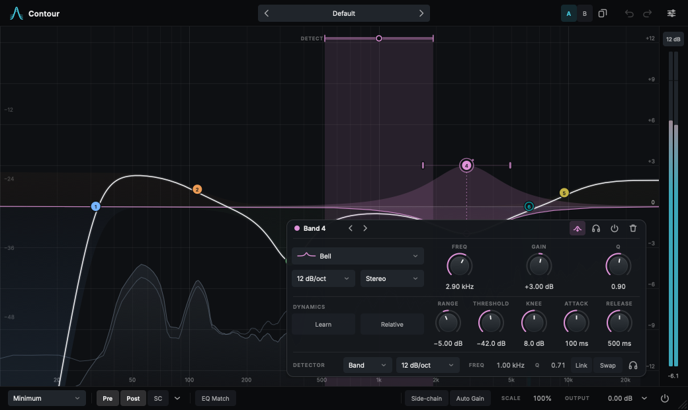

# Contour

A parametric and dynamic equalizer with a fast, precise, minimal interface, built on the audio engine of
[ZL Equalizer 2](https://github.com/ZL-Audio/ZLEqualizer).



- **A curve you can trust.** Response curves are computed from the engine's actual filter coefficients in every
  processing mode, and tested against the processed audio (within 0.01 dB in the zero-latency modes).
- **Direct manipulation.** Drag nodes for frequency and gain, side handles for Q, scroll for Q, drag the dynamic
  range directly, lasso and move groups, grab a resonance straight off the analyzer.
- **Controls when you need them.** A contextual band panel follows the selected band; dynamics and side-chain
  detector settings appear only for dynamic bands.
- **Up to 24 bands**, 11 shapes, 6–96 dB/oct, stereo / left / right / mid / side placement, dynamic EQ with an
  editable detector filter, external side-chain, six processing structures from zero-latency minimum phase to
  linear phase.
- **EQ Match** to the side-chain, a reference curve or a file, with a drawable correction and progressive fitting.
- Presets (compatible with ZL Equalizer 2), A/B compare, undo/redo, loudness match, piano roll, collision display,
  adjustable interface size and accent colour, keyboard control and screen-reader support.

## Using Contour

| Action | Gesture |
|---|---|
| Add a band | Double-click the graph (Option for a shelf), or right-click for a shape |
| Move a band | Drag its node; Shift for fine, Cmd to lock an axis |
| Q / width | Drag the side handles, or scroll over the node |
| Gain while scrolling | Option + scroll |
| Bypass / delete | Double-click the node / Option-click or Delete |
| Listen to a band | Hold S over it, or the headphones button |
| Select several | Drag a lasso, Shift-click; Cmd+A for all |
| Copy, paste, duplicate | Cmd+C, Cmd+V, Cmd+D |
| Nudge | Arrow keys (Shift for fine) |
| Cycle bands | Tab / Shift+Tab |
| Undo / redo | Cmd+Z / Shift+Cmd+Z |

Values can be typed: double-click a knob's value and enter `1.2k`, `440`, `A4` or `-3.5`.

## Build from source

Requirements: Clang (AppleClang 16+ or LLVM/Clang 17+), CMake 3.25+ and Ninja. On Linux also install:

```console
sudo apt install libasound2-dev libx11-dev libxcomposite-dev libxcursor-dev libxext-dev libxinerama-dev \
  libxrandr-dev libxrender-dev libfreetype-dev libfontconfig1-dev libxi-dev
```

```console
git clone --recursive <this repository> contour
cd contour

# macOS (Apple silicon)
cmake --preset mac-arm64-release
cmake --build --preset mac-arm64-release

# any platform
cmake -B Builds -G Ninja -DCMAKE_BUILD_TYPE=Release -DZL_JUCE_FORMATS="VST3;LV2" -DZL_HWY_STATIC_TARGET=AVX2 .
cmake --build Builds
```

Options:

- `ZL_JUCE_FORMATS`: plug-in formats, e.g. `"VST3;AU;Standalone"`.
- `ZL_HWY_STATIC_TARGET`: SIMD target, one of `SSE2`, `SSE4`, `AVX2` (x86-64) or `NEON` (arm64). Required.
- `ZL_EQ_BAND_NUM`: number of bands, 24 by default. Builds with different band counts are not session-compatible.
- `ZL_JUCE_COPY_PLUGIN`: copy plug-ins to the system folders after building (on by default).
- `CONTOUR_BUILD_TESTS`: build the `Tests` executable.
- `CONTOUR_BUILD_TOOLS`: build `ContourSnapshot` (headless screenshots for visual review) and `ContourIcons`.

```console
cmake --preset mac-arm64-debug -DCONTOUR_BUILD_TESTS=ON -DCONTOUR_BUILD_TOOLS=ON
cmake --build --preset mac-arm64-debug
build/mac-arm64-debug/Tests
build/mac-arm64-debug/ContourSnapshot snapshots/
```

Releases are built by the `Release` workflow; macOS packages are signed and notarized when the signing secrets are
configured. Versions come from `contour-vX.Y.Z` tags.

See [docs/ARCHITECTURE.md](docs/ARCHITECTURE.md) for how the editor is put together.

## Relationship to ZL Equalizer

Contour is a fork. The audio engine (`source/dsp`, `source/zlp`, `source/chore`) is ZL Equalizer's and is kept
unmodified, which CI checks, so upstream improvements can be merged as they are. The interface in `source/ui` is new.
Contour reads and writes ZL Equalizer 2 presets and sessions, and installs alongside it.

## AI transparency

Contour's interface was developed with the help of an AI coding assistant (Claude). Its output is reviewed by the
maintainer, who takes responsibility for the quality, safety and licensing of the result. The upstream engine carries
its own note: since October 2026, LLMs have assisted across stages of ZL Equalizer's development.

## License

Contour is licensed under the GNU Affero General Public License v3; see [LICENSE.md](LICENSE.md) and
[NOTICE.md](NOTICE.md).

- Audio engine from [ZL Equalizer](https://github.com/ZL-Audio/ZLEqualizer), copyright (c) 2023-2026
  [zsliu98](https://github.com/zsliu98)
- [JUCE](https://github.com/juce-framework/JUCE), template from [pamplejuce](https://github.com/sudara/pamplejuce)
- [nlopt](https://github.com/stevengj/nlopt) by Steven G. Johnson
- [Highway](https://github.com/google/highway) by Google
- [Inter](https://github.com/rsms/inter) by The Inter Project Authors (SIL Open Font License)

## References

Yuriy Ivantsov. *On the Ideal Bilinear and Biquadratic Digital Filter*. (2025).

Yuriy Ivantsov. *On the State Space of a Linear Digital Filter*. (2025).

Cleve Moler. [*Makima Piecewise Cubic Interpolation*](https://blogs.mathworks.com/cleve/2019/04/29/makima-piecewise-cubic-interpolation/). MathWorks Blogs. (2019).

Nigel Redmon. *Cascading filters*. (2016).

Martin Vicanek. *Matched One-Pole Digital Shelving Filters*. (2019).

Martin Vicanek. *Matched Second Order Digital Filters*. (2016).

Aaron Wishnick. *Time-Varying Filters for Musical Applications*. DAFx. (2014).
