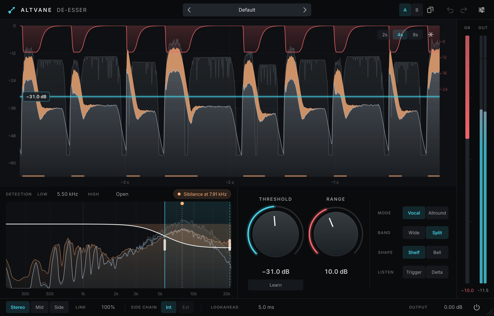

# Altvane De-Esser

A de-esser that knows an ess from a bright vowel. Set it by ear, by eye or by letting it listen: it shows what it
takes from each ess as it happens, finds where a voice's sibilance lives, and can set its own threshold from a
passage.



- **Vocal and Allround detection.** Vocal mode weighs the sibilance band against the body of the voice under it, so
  a bright vowel or an open, airy voice is left alone while the esses are caught; Allround reacts to anything in the
  band, for mixes, buses, cymbals and guitars.
- **Wide or split band, shelf or bell.** Split band turns down only the top end, as a dynamic high shelf from the
  band's low edge or as a dynamic bell over the band alone (sparing the air above it). With nothing to reduce the
  output is the input, sample for sample, in every mode.
- **See every ess.** The history scrolls the signal and its sibilance band under the threshold, bites what was taken
  out of each ess in the sibilance colour, hangs the gain reduction from the top, and marks along the floor where
  sibilance was heard. Drag the threshold right there.
- **Sibilance finder.** While audio plays it learns the average spectrum of the esses and pins their peak on the band
  view; one click fits the band to them.
- **Learn.** Play a passage and the threshold is set so a typical ess loses about 4 dB and louder ones more.
- **Trigger and Delta.** Hear the detection band to place it, or hear only what is being taken away.
- Look-ahead up to 15 ms, stereo link, mid or side only, external side chain, output gain.
- Presets with a factory set, A/B compare, undo/redo, adjustable interface size and accent colour, keyboard control,
  screen-reader support and host parameter menus.

## Using Altvane De-Esser

| Action | Gesture |
|---|---|
| Set the threshold | Drag the line in the history (Shift for fine), or the Threshold knob; double-click the line to reset |
| Learn the threshold | **Learn** (or L), play a passage with esses, then **Learn** again (it also stops by itself after 16 esses) |
| Move the detection band | Drag inside it; drag an edge to move that edge; scroll inside it to widen or narrow it |
| Open or close the band's top | Drag the high edge to the far right, or double-click it |
| Fit the band to the esses | Click the finder's pill (**Sibilance at …**) once it appears |
| Hear what it listens to / takes | **Trigger** / **Delta** |
| Freeze the history | Click it, or press F (Esc to go on) |
| Read a moment | Hover the history |
| Reset a control | Cmd-click or double-click it |
| Undo / redo | Cmd+Z / Shift+Cmd+Z |

Start from **Vocal**, **Split** and **Shelf** with the band's low edge where the esses begin (the finder shows
where that is). Use **Bell** when the voice has air above the esses worth keeping, **Wide** for the most natural
result on a dry voice, and **Allround** for anything that is not a single voice.

## How it works

The side chain (the track, or an external input) passes the detection band, a fourth-order high-pass and an optional
fourth-order low-pass, and a peak envelope follows the band's level. In Vocal mode a slower envelope of the band is
compared with one of everything below it: an ess is about as loud as the voice under it, a vowel's high harmonics
sit 20 to 30 dB below its body, and the difference scales how much of the overshoot counts. The reduction is the
band's level above the threshold through a 6 dB soft knee, limited by the range, held for the look-ahead so it is in
place when the ess arrives, and released faster after short esses than long ones.

The audio is delayed by the look-ahead and the reduction mixed in: the whole signal (Wide), a second-order high shelf
whose midpoint stays on the band's low edge however deep it goes (Shelf), or a bell whose edges are the band's
(Bell). Each is written as the input plus what changes, so it is exact when nothing changes. See
[docs/ARCHITECTURE.md](docs/ARCHITECTURE.md) and [docs/BENCHMARK.md](docs/BENCHMARK.md).

## Build from source

Altvane De-Esser is built from the [Altvane monorepo](../../README.md); see its README for requirements and options.
It builds on every platform.

```console
cmake --preset mac-arm64-debug -DALTVANE_PRODUCTS=deesser -DALTVANE_BUILD_TESTS=ON -DALTVANE_BUILD_TOOLS=ON
cmake --build --preset mac-arm64-debug
ctest --test-dir build/mac-arm64-debug
```

Tools, with `ALTVANE_BUILD_TOOLS`:

- `AltvaneDeEsserRender <in.wav | voice> <out.wav> [id=value ...] [listen=trigger|delta]` renders a file (or a
  synthetic voice) latency-compensated, with any parameter set by its ID (`threshold=-30 shape=1`);
  `AltvaneDeEsserRender --bench [seconds] [block]` measures the CPU of one instance.
- `AltvaneDeEsserSnapshot <out-dir> [scale]` renders the editor's states to PNGs, playing a synthetic voice.

Releases are built by the `Release` workflow from `deesser-vX.Y.Z` tags.

## AI transparency

Altvane De-Esser was developed with the help of an AI coding assistant (Claude). Its output is reviewed by the
maintainer, who takes responsibility for the quality, safety and licensing of the result.

## License

Altvane De-Esser is licensed under the GNU AGPL v3 (`LICENSE.md` at the root). It uses r8brain's copy of PFFFT for
its spectrum, which is permissively licensed; see `NOTICE.md` and `licenses/`.
