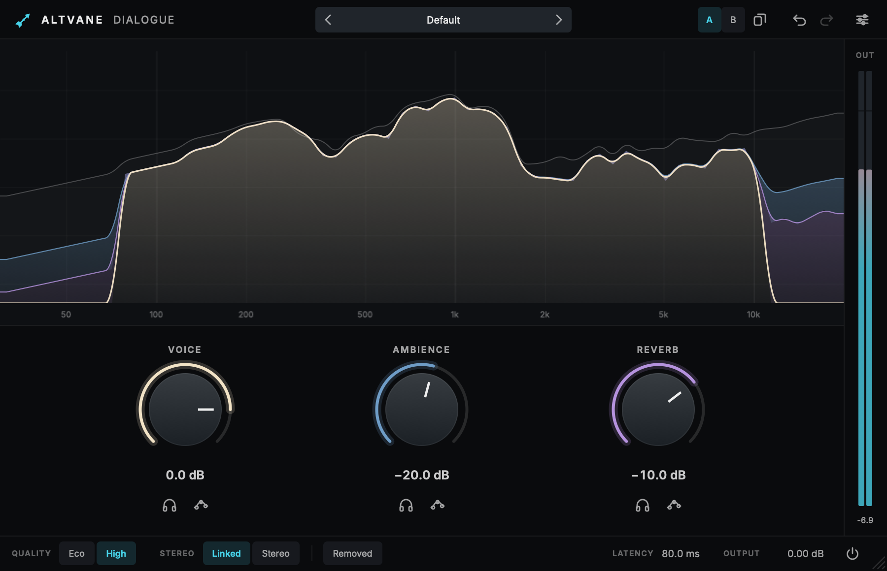

# Altvane Dialogue

Neural dialogue isolation with three levels: the voice, the ambience around it, and the reverb of the voice.
Pull a voice out of a noisy location recording, dry out a reverberant room, or keep only the room for an M&E track.



- **Three knobs.** Voice, Ambience and Reverb, each from Off to +12 dB. The stems always add up to the input, so
  with every level at 0 dB the plug-in is transparent, sample for sample.
- **See what you keep.** The spectrum stacks what each stem keeps at its level, under a faint outline of the input:
  turn the ambience down and its layer shrinks. Solo a stem, or press **Removed** to hear exactly what is being
  taken away.
- **Sensitivity across the spectrum.** Each stem has a six-point curve (120 Hz to 11 kHz): raise the voice's curve
  at the top to keep consonants, raise the ambience's at the bottom to clear rumble and wind.
- **Eco or High** quality, **Linked** (one analysis of the mid, applied to both channels) or **Stereo** (each
  channel on its own), 44.1–192 kHz, mono or stereo.
- A fixed, reported latency (about 80 ms at 512-sample buffers), so hosts compensate it exactly. Offline bounces
  wait for the model; in real time, a frame that would arrive late plays unprocessed rather than dropping out.
- Presets with a factory set, A/B compare, undo/redo, adjustable interface size and accent colour, keyboard control,
  screen-reader support and host parameter menus.

## Using Altvane Dialogue

| Action | Gesture |
|---|---|
| Change a level | Drag the knob (Shift for fine), scroll, or double-click the value and type (`-12`, `off`) |
| Reset a level | Cmd-click or double-click the knob |
| Hear one stem | The headphones under its knob |
| Hear what is removed | **Removed** in the footer |
| Shape a stem's sensitivity | The curve button under its knob, then drag the nodes; double-click a node to reset it, Esc to close |
| Undo / redo | Cmd+Z / Shift+Cmd+Z |

Sensitivity moves sound between stems: raising the voice's curve at a frequency makes more of what is there count as
voice, lowering it less. The stems still add up to the input.

## How it works

The separation runs at 48 kHz on 20 ms frames with a 10 ms hop. A causal speech-enhancement network,
[DPDFNet](https://huggingface.co/Ceva-IP/DPDFNet) (Ceva, Apache-2.0; Eco runs the 2-layer model, High the 8-layer
one), estimates the speech in each frame; what it leaves is the ambience. The late reverb of the voice is then
predicted from the voice's energy 50 ms earlier and taken from both in proportion. Other sample rates are converted to
48 kHz and back, and what that round trip loses (everything above about 20 kHz) is added back from the input,
following the ambience level. See [docs/ARCHITECTURE.md](docs/ARCHITECTURE.md) and
[models/README.md](models/README.md).

CPU on an M5 Max, per instance, as a share of one core: Eco 8%, High 22% (Linked; twice that in Stereo mode).

## Build from source

Altvane Dialogue builds on macOS 11 or newer (Apple silicon and Intel) and on Windows x64 (`PLATFORMS`). Configuring
builds a small, static ONNX Runtime once (`scripts/build_onnxruntime.py`, a few minutes, needs Python 3.10 or newer)
and downloads the models at a pinned revision; both land in `build/deps/`.

```console
cmake --preset mac-arm64-debug -DALTVANE_PRODUCTS=dialogue -DALTVANE_BUILD_TESTS=ON -DALTVANE_BUILD_TOOLS=ON
cmake --build --preset mac-arm64-debug
ctest --test-dir build/mac-arm64-debug
```

For an Intel Mac, configure with `-DCMAKE_OSX_ARCHITECTURES=x86_64 -DALTVANE_SIMD_TARGET=SSE4` instead of the
preset (from either kind of Mac). On Windows, configure from a Visual Studio x64 developer prompt with clang-cl, as CI
does:

```console
cmake -B Builds -G Ninja -DCMAKE_BUILD_TYPE=Release -DCMAKE_C_COMPILER=clang-cl -DCMAKE_CXX_COMPILER=clang-cl ^
  -DALTVANE_PRODUCTS=dialogue -DALTVANE_FORMATS="VST3;Standalone" -DALTVANE_SIMD_TARGET=AVX2 .
cmake --build Builds
```

ONNX Runtime itself is built with MSVC and the static runtime; a Debug build of the plug-in builds a Debug ONNX
Runtime alongside, as the two runtimes don't mix.

Tools, with `ALTVANE_BUILD_TOOLS`:

- `AltvaneDialogueRender <in.wav> <out-dir>` writes the mix and each stem of a file, latency-compensated, and
  reports the CPU it took (`--quality`, `--stereo`, `--voice/--ambience/--reverb` in dB, `--block`, `--realtime`).
- `AltvaneDialogueSnapshot <out-dir> [scale] [speech.wav]` renders the editor's states to PNGs.

## License

Altvane Dialogue is licensed under the GNU AGPL v3 (`LICENSE.md` at the root). The DPDFNet models are Apache-2.0,
ONNX Runtime and r8brain's PFFFT are permissively licensed; see `NOTICE.md` and `licenses/`.
