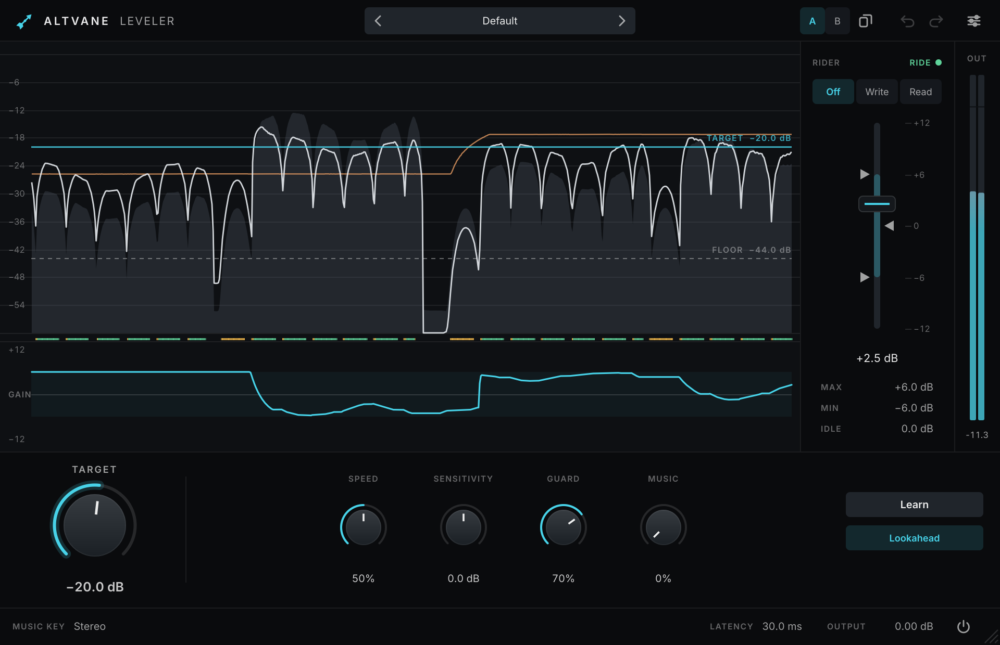

# Altvane Leveler

An automatic vocal rider. It moves a fader for you so a vocal or voice-over sits at a steady level: it boosts the
quiet phrases, pulls back the loud ones, and leaves breaths, sibilants and silence alone. Ride in real time, or write
the moves to your host's automation and edit them there.



- **Moves before the phrase, not after it.** With lookahead (30 ms, reported to the host), the gain is already in
  place when a phrase starts. Riders that react after the fact leave the first syllable too quiet. Turn lookahead
  off for zero latency when tracking or live (it changes the latency, so it is not automatable).
- **Hears the voice, not just the level.** A pitch detector tells sung and spoken voice apart from breaths,
  sibilants, noise and drum spill. **Guard** sets how firmly those are kept from moving the fader, so a breath before
  a quiet phrase is not boosted 10 dB.
- **Rides like a person would.** Holds through the gaps between syllables, drifts to the **Idle** gain only after a
  longer silence, and cuts twice as fast as it boosts. **Speed** is continuous, from 1.5 s to 40 ms.
- **Follows the music.** Put the instrumental bus on the **Music** side chain (mono or stereo). The target rises
  when the chorus gets louder and falls when the verse thins out.
- **See every move.** An 8-second history shows the input, the leveled output, the music, the target and the
  sensitivity floor (drag both), the gain itself, and what the detector heard.
- **Rider fader with automation.** **Off** rides. **Write** sends the fader to the host's automation while the
  transport plays. **Read** follows that automation instead. Grab the fader to ride by hand at any time.
- **Learn** sets the target from the voice's own loudness. The range is up to ±24 dB. Levels are BS.1770
  (LUFS-style) loudness.
- Presets with a factory set, A/B compare, undo/redo, adjustable interface size and accent colour, keyboard control,
  screen-reader support and host parameter menus. 44.1–192 kHz, mono or stereo, under 1% of a core.

## Using Altvane Leveler

| Action | Gesture |
|---|---|
| Set where the voice sits | **Target**, drag the TARGET line in the history, or **Learn** while the voice plays, then **Stop** |
| Ignore quieter sounds (or catch quieter singing) | **Sensitivity**, or drag the FLOOR line: the floor sits 24 dB below the target |
| Limit the ride | The handles left of the fader, or MAX and MIN under it |
| Where the fader rests in silence | The marker right of the fader, or IDLE |
| Ride by hand | Grab the fader; it goes back to riding when you let go |
| Write automation | **Write**, arm the **Rider** parameter in the host (write, touch or latch), play |
| Play back and edit written automation | **Read**, then edit the Rider lane in the host |
| Follow the music | Send the instrumental bus to the plug-in's **Music** side chain, raise **Music** |
| Change a value | Drag (Shift for fine), scroll, or double-click the value and type |
| Reset a value | Cmd-click or double-click |
| Undo / redo | Cmd+Z / Shift+Cmd+Z |

The rider fader is its own parameter. Presets and A/B never move it, and loading a preset never changes the
automation mode. In Write mode the host records the fader like a hand on a control surface: the plug-in sends the
fader's position from its interface about 60 times a second, and the host stamps each move when it arrives. So the
written lane is not sample-accurate. It lags the audio it belongs to by up to the lookahead (30 ms) plus a host
buffer or two, less in hosts that compensate automation for the plug-in's latency. Nudge the lane earlier if a move
must land exactly on a syllable.

## How it works

The input is measured as it arrives, on a 5 ms hop. K-weighted loudness is taken over 20 ms (for the floor) and over
100 ms of voiced hops only (for riding). A YIN pitch-confidence detector runs on the signal decimated to about 8 kHz.
Each hop is voiced, unvoiced (breath, sibilant, noise) or silent. The rider moves the gain toward
`target − level` within the range, and the audio is delayed by the lookahead before the gain is applied, so its moves
lead the sound. With the music key, the target follows the key's loudness relative to its own 30-second memory. See
[docs/ARCHITECTURE.md](docs/ARCHITECTURE.md) and [docs/BENCHMARK.md](docs/BENCHMARK.md).

## Build from source

Altvane Leveler is built from the [Altvane monorepo](../../README.md); see its README for requirements and options.

```console
cmake --preset mac-arm64-debug -DALTVANE_PRODUCTS=leveler -DALTVANE_BUILD_TESTS=ON -DALTVANE_BUILD_TOOLS=ON
cmake --build --preset mac-arm64-debug
ctest --test-dir build/mac-arm64-debug
```

Tools, with `ALTVANE_BUILD_TOOLS`:

- `AltvaneLevelerRender <in.wav> <out-dir>` levels a file, latency-compensated, and writes the gain curve as CSV. It
  prints the voiced level spread before and after, the CPU it took and the latency. Options: `--key music.wav`,
  `--target`, `--sensitivity`, `--min`, `--max` and `--idle` in dB, `--speed`, `--guard` and `--music` in %,
  `--lookahead on|off`, `--block`.
- `AltvaneLevelerSnapshot <out-dir> [scale] [vocal.wav [music.wav]]` renders the editor's states to PNGs.

Releases are built by the `Release` workflow from `leveler-vX.Y.Z` tags.

## AI transparency

Altvane Leveler was developed with the help of an AI coding assistant (Claude). Its output is reviewed by the
maintainer, who takes responsibility for the quality, safety and licensing of the result.

## License

Altvane Leveler is licensed under the GNU AGPL v3; see [LICENSE.md](../../LICENSE.md) and [NOTICE.md](../../NOTICE.md).
