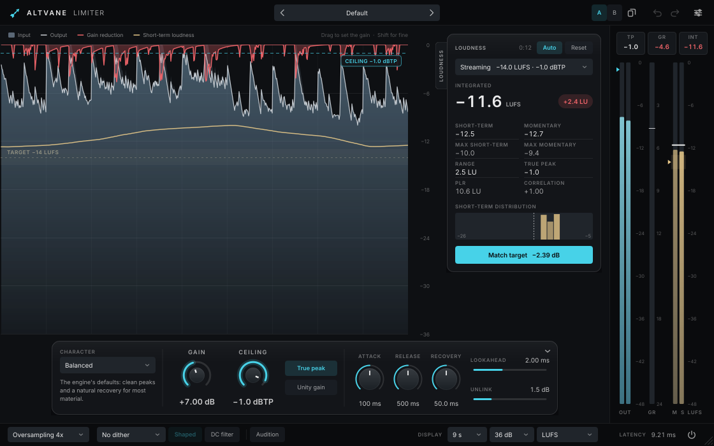

# Altvane Limiter

A true-peak limiter and loudness meter for mastering, built on the audio engine of
[ZL Limiter](https://github.com/ZL-Audio/ZLLimiter).



- **Limiting:** gain, ceiling (true peak or sample peak), up to 32× oversampling, lookahead up to 5 ms at a fixed
  latency, attack, release, adaptive recovery and stereo unlink. Unity gain takes the gain back off the output so you
  hear the limiting at the same level, and Audition plays only what the limiter removes.
- **Character:** five starting points for the timing (Transparent, Balanced, Punchy, Aggressive, Safe), ordered from
  gentle to loud. They set the timing controls together; they are presets, not separate algorithms.
- **Loudness:** an ITU-R BS.1770-4 / EBU R128 meter (momentary, short-term, integrated, loudness range, maxima, true
  peak, PLR) that runs in the audio engine, so it keeps measuring with the editor closed and in offline renders.
  Delivery targets (Streaming, Apple Music, YouTube, EBU R128, ATSC A/85, Podcast, CD / Club, Custom) are drawn on the
  display and the meters. **Match target** moves the gain by the difference to the target in one step.
- **Display:** the gained input, the output and the gain reduction scroll by with the short-term loudness and the
  target band. Drag the waveform up or down to set the gain; drag the ceiling line to move the ceiling.
- **Output stage:** TPDF dither to 24, 20 or 16 bits, flat or noise shaped, and a DC filter before the limiter.
- **Presets and sessions** use ZL Limiter's format. A/B, undo and redo, help balloons and interface scaling come
  from the shared Altvane editor shell.

## Build from source

Altvane Limiter is built from the [Altvane monorepo](../../README.md); see its README for requirements and options.

```console
cmake --preset mac-arm64-release -DALTVANE_PRODUCTS=limiter
cmake --build --preset mac-arm64-release
```

With `ALTVANE_BUILD_TESTS=ON` the build also produces `AltvaneLimiterTests`, and with `ALTVANE_BUILD_TOOLS=ON` the
snapshot renderer `AltvaneLimiterSnapshot <out-dir> [scale] [music.wav]` (on Linux, run it under `xvfb-run`).

Releases are built by the `Release` workflow from `limiter-vX.Y.Z` tags.

See [docs/ARCHITECTURE.md](docs/ARCHITECTURE.md) for how the product is put together.

## Relationship to ZL Limiter

Altvane Limiter is a fork. The audio engine (`source/dsp`, `source/zlp`, `source/chore`) is ZL Limiter's, vendored
unmodified from the upstream commit pinned in [UPSTREAM](UPSTREAM), which CI checks; `scripts/sync_upstream.sh limiter`
brings in newer upstream engine code. ZL Limiter is a work in progress upstream, so expect regular syncs. The
interface in `source/ui`, the output stage and the loudness meter in `source/engine` are new. Altvane Limiter uses ZL
Limiter's parameters (plus its own for dither and the DC filter), preset format and session format, and installs
alongside it.

## AI transparency

Altvane Limiter's interface and output stage were developed with the help of an AI coding assistant (Claude). Its
output is reviewed by the maintainer, who takes responsibility for the quality, safety and licensing of the result.

## License

Altvane Limiter is licensed under the GNU Affero General Public License v3; see [LICENSE.md](../../LICENSE.md) and
[NOTICE.md](../../NOTICE.md).

- Audio engine from [ZL Limiter](https://github.com/ZL-Audio/ZLLimiter), copyright (c) 2023-2026
  [zsliu98](https://github.com/zsliu98)
- Noise shaping filter from R. A. Wannamaker, "Psychoacoustically Optimal Noise Shaping", J. Audio Eng. Soc. 40(7/8),
  1992
- [JUCE](https://github.com/juce-framework/JUCE), template from [pamplejuce](https://github.com/sudara/pamplejuce)
- [Highway](https://github.com/google/highway) by Google
- [Inter](https://github.com/rsms/inter) by The Inter Project Authors (SIL Open Font License)
